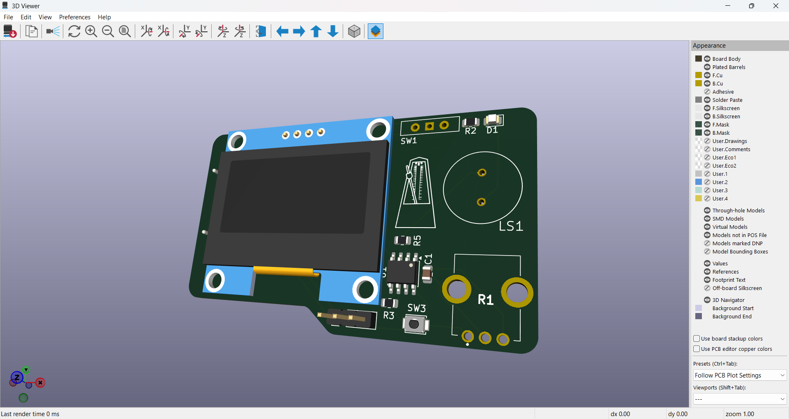
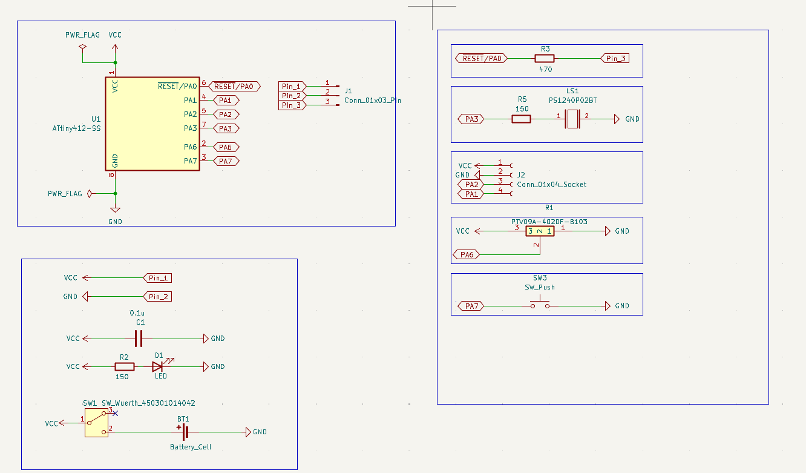
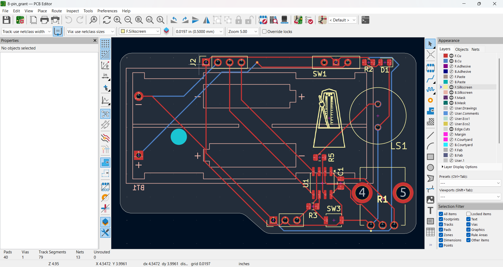

# Metronome Clock for Musicians

A pocket-sized digital metronome powered by the **ATtiny412**, featuring a 1.3-inch monochrome OLED display and simple physical controls.

---

## Features

- **ATtiny412 Microcontroller** — Compact AVR microcontroller handling the metronome and user interface.
- **OLED Display** — 1.3-inch monochrome I²C display for visual feedback and interface.
- **Physical Controls** — Simple button and potentiometer-based input.
- **Piezoelectric Buzzer** — Provides audible metronome beats.
- **AAA Battery Powered** — Operates using two standard AAA batteries.
- **UPDI Programming** — Supports firmware programming and experimentation through the UPDI interface.
- **Custom PCB** — Designed and developed using KiCad.

## Hardware

| Component       | Description                  |
| :---            | :---                         |
| Microcontroller | ATtiny412                    |
| Display         | 1.3-inch I²C Monochrome OLED |
| Input           | 1× Push Button               |
| Input           | 1× Potentiometer             |
| Sound           | 1× Piezoelectric Buzzer      |
| Power           | 2× AAA Batteries             |
| Programming     | UPDI                         |

## Gallery

### Schematics

### PCB Design

## Firmware

The firmware implements a simple metronome interface with accessible physical controls.

The ATtiny412's UPDI programming interface also allows compatible firmware to be flashed onto the microcontroller, making it possible to experiment with additional custom applications.

## PCB Design

The schematic and PCB layout were designed using **KiCad**.

All project design files and development documentation are maintained in this repository.

## Development Journal

Follow the project's engineering progress, design decisions, technical challenges, and development milestones in [LOG.md](LOG.md).

---

**Designed by legend1243 (Chen E-Chen)**